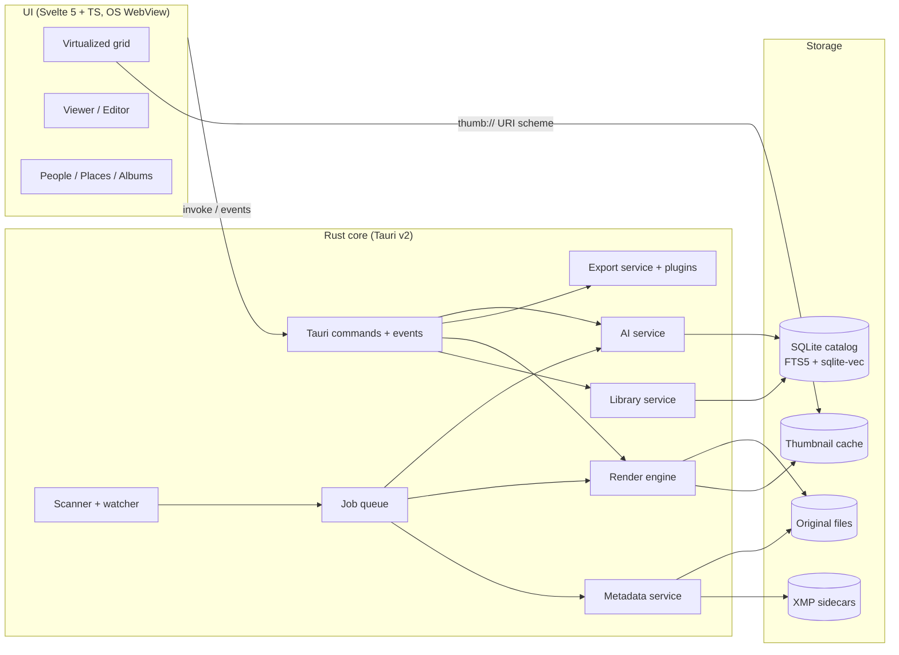
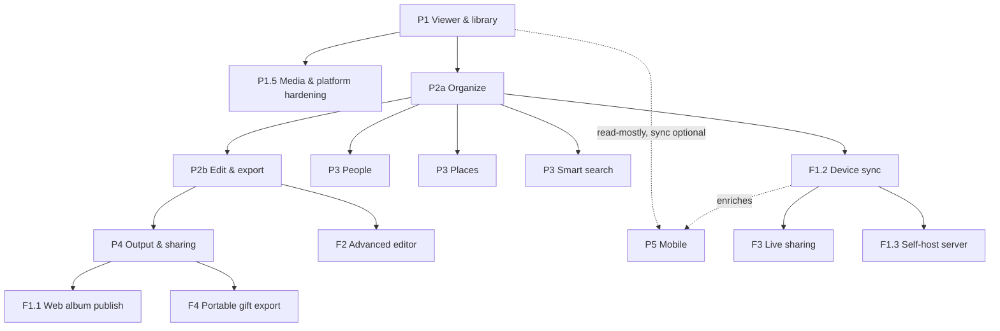

# Fotobase — Product & Technical Plan

A local-first, open-source, cross-platform photo organizer inspired by Google Picasa (2002–2016), rebuilt with a modern, low-resource stack. Working name: **Fotobase** (photo + database — the catalog *is* the product). Chosen 2026-10-20 after a name-collision sweep of ~20 candidates (see §11, question 3, for the decision record).

## 1. Goals & constraints

| Goal              | Detail                                                                                |
| ----------------- | ------------------------------------------------------------------------------------- |
| Native on desktop | Windows 10 22H2+, macOS 12+ (Apple Silicon + Intel), Ubuntu 22.04+ (x64, arm64) — decided 2026-10-20, see §11 Q4 |
| Mobile            | iOS / Android are a plus, not required for v1                                         |
| Low resources     | Target < 150 MB RAM idle with a 50k-photo library, < 20 MB installer, instant startup |
| Local-first       | Works fully offline; no account required; cloud is opt-in via export plugins          |
| Non-destructive   | Originals are never modified unless the user explicitly chooses "Save"                |
| Interoperable     | Metadata in standard XMP sidecars readable by darktable, digiKam, Lightroom           |
| Private AI        | Face recognition and smart search run on-device, models are opt-in downloads          |
| Open source       | GPL-3.0 (required by exiv2 dependency)                                                |

### Target user & positioning (2026-10-20 review)

- **Primary:** the photo *enthusiast* who left (or never joined) the cloud — shoots RAW, wants XMP interop with darktable/digiKam, values offline and privacy, and often runs older hardware.
- **Secondary:** the casual family user who wants "Picasa again" — simple, fast, no account. The enthusiast-first stack must not price these users out: defaults stay simple, pro features stay opt-in.
- **One-sentence answer to "why not Immich?":** *Fotobase is a desktop app, not a server — it runs fully offline on a 10-year-old laptop under 150 MB of RAM, with zero setup, while Immich needs a Docker host and multiple GB.* Lean into "runs on old hardware" as the anti-bloat differentiator.
- **Onboarding hook:** the Picasa diaspora — "your old library, restored" (Picasa.ini ingest, P2a) is the marketing headline for first adoption.
- **Adjacent market:** a lightweight desktop *client* for existing Immich servers (see P4 export plugins) — potentially bigger than the standalone audience.

### Decisions taken

- **Language / shell:** Rust core + Tauri v2 + TypeScript (Svelte 5) UI.
- **Cloud:** no first-party cloud in v1; pluggable export targets (Immich, Google Photos, S3, WebDAV…).
- **AI:** fully on-device, opt-in, **permissively-licensed models only** (goal: the full face + CLIP stack must be usable in GPL distribution without license exceptions — a differentiator for other OSS projects too).
- **License:** open source, GPL-3.0.
- **Telemetry:** none. No analytics, no crash reporting, no phone-home of any kind.
- **Catalog:** the app works against a single, user-configurable **catalog location** on the computer — the place where imported images are gathered and where all metadata lives (SQLite catalog database, thumbnail cache, ML models). Folders that already exist elsewhere on disk are indexed in place: the catalog references them rather than copying.

---

## 2. Picasa feature inventory (reference: Picasa 3.9)

Source notes: Wikipedia (Picasa article) plus Picasa 3.9 product knowledge. Google's official feature pages are no longer available. A menu-by-menu walkthrough of the Picasa 3.9 UI (2026-10-20) is captured in the **Menus & dialogs** section at the end of this chapter — that section is the authoritative feature list; the tables above give the per-domain summary.

Legend for **Phase**: P1–P5 = core roadmap, F1–F4 = future features (see §7, §8).

### A. Library & import

| Feature         | What it did                                                                                                                                                      | Phase       |
| --------------- | ---------------------------------------------------------------------------------------------------------------------------------------------------------------- | ----------- |
| Folder Manager  | Per folder: _Scan Once_, _Scan Always_ (watched) or _Remove from Picasa_. The library mirrors real disk folders; files are never moved into a proprietary store. | P1          |
| Watched folders | Background watcher picks up new/changed/deleted files in "Scan Always" folders.                                                                                  | P1          |
| Import          | Import from camera, card reader, scanner, webcam, CD. Duplicate detection, destination folder naming (date / custom), optional "delete from card after import".  | P1          |
| Screen capture  | PrtScn key saved screenshots directly into a "Screen Captures" library folder.                                                                                   | P4          |
| Format support  | JPEG, PNG, GIF, BMP, TIFF, PSD, WebP, most camera RAW, common video formats (thumbnails + playback).                                                             | P1 (RAW P2) |
| Hidden folders  | Hide folders from the library; optional password protection.                                                                                                     | P2          |

### B. Organization

| Feature             | What it did                                                                                                                                 | Phase |
| ------------------- | ------------------------------------------------------------------------------------------------------------------------------------------- | ----- |
| Folders view        | Real on-disk folder tree, grouped by year.                                                                                                  | P1    |
| Albums              | Virtual collections; created with name + date and optional place and description; deletable. A photo can be in many albums without copying. | P2    |
| Star                | Single favorite flag per photo; filter on starred.                                                                                          | P2    |
| Tags / keywords     | Keywords written as IPTC into JPEG (readable by other apps).                                                                                | P2    |
| Quick Tags          | Panel with 10 one-click tag buttons.                                                                                                        | P2    |
| Captions            | Per-photo caption stored in metadata, searchable.                                                                                           | P2    |
| Photo Tray          | Temporary cross-folder selection at the bottom of the window; actions (export, email, print, upload) apply to the tray. "Hold" pins items.  | P2    |
| Batch rename / move | Rename to a pattern (`name-1, name-2…`), drag between folders (real file moves).                                                            | P2    |
| Timeline view       | Full-screen chronological browsing of folders by date.                                                                                      | P4    |
| Find duplicates     | Exact duplicate file detection; "Show duplicate pictures" tool in the Tools menu. (Import-level duplicate _exclusion_ ships earlier — P1.)  | P2    |

### C. Search & filter

| Feature         | What it did                                                                            | Phase                              |
| --------------- | -------------------------------------------------------------------------------------- | ---------------------------------- |
| Live search bar | Filters while typing across filenames, captions, tags, folder names, people, metadata. | P1 (files/folders), P2 (metadata)  |
| Color search    | Experimental `color:red` operator finds photos dominated by a color.                   | P4 (superseded by semantic search) |
| Filter buttons  | Show only starred, videos, photos with faces, geotagged.                               | P2 / P3                            |
| Date slider     | Restrict library to last N days/months.                                                | P2                                 |

### D. Viewing

| Feature                | What it did                                                                                                                                                                 | Phase                                |
| ---------------------- | --------------------------------------------------------------------------------------------------------------------------------------------------------------------------- | ------------------------------------ |
| Thumbnail grid         | Zoomable grid with size slider.                                                                                                                                             | P1                                   |
| Lightbox               | Larger-thumbnail compare mode.                                                                                                                                              | P2                                   |
| Picasa Photo Viewer    | Fast standalone viewer, could replace the OS default on double-click.                                                                                                       | P1                                   |
| Edit view              | Single photo with edit tabs and filmstrip.                                                                                                                                  | P1 (viewer) / P2 (edit)              |
| Side-by-side compare   | Compare two photos.                                                                                                                                                         | P2                                   |
| Fullscreen / slideshow | Transitions, timing, captions, background music.                                                                                                                            | P1 (basic) / P4 (music, transitions) |
| Map view               | Library-level world map with a pin (or cluster) for every geotagged photo in the catalog; zooming resolves clusters into individual photos; clicking a pin opens the photo. | P3                                   |
| Info pane              | EXIF (camera, lens, exposure), histogram, file properties.                                                                                                                  | P1                                   |
| Video playback         | Play video; basic trim; export a frame.                                                                                                                                     | P1.5 (play) / P4 (trim, frame)       |

### Video strategy (video is a first-class citizen)

Video support is spread across phases, so the strategy is pinned here (2026-10-20):

- **Decode/playback:** HTML5 `<video>` in the WebView *when the OS WebView actually has the codec* — but WebKitGTK on Fedora/Debian frequently ships **without H.264/HEVC**, so HTML5-first is not enough. Playback flow: probe codec support at startup → if a clip's codec is unsupported, fall back to on-the-fly ffmpeg transcode (to a supported intermediate, e.g. H.264/mp4 or VP9/webm) streamed to the player via a custom `stream://` URI scheme. HTML5 stays the primary path; transcode is the compatibility floor.
- **Thumbnails:** ffmpeg-extracted frames cached in the same thumbnail store as images; same `thumb://` scheme, same job queue, lower priority than visible images.
- **Metadata (duration, codec, rotation):** extracted at scan time via ffprobe, stored in the catalog `metadata` table.
- **Licensing:** ship an LGPL ffmpeg build without non-free codecs; use OS decoders first (see §10 risk row).
- **Phasing:** playback P1.5, trim/frame-export P4, Live/Motion Photos P4.

### E. Editing

**Basic Fixes tab**

| Tool                       | What it did                                                 | Phase |
| -------------------------- | ----------------------------------------------------------- | ----- |
| Crop                       | Free and preset aspect ratios.                              | P2    |
| Straighten                 | Small-angle rotate with auto-crop.                          | P2    |
| Red-eye                    | Auto and manual red-eye removal.                            | P2    |
| I'm Feeling Lucky          | One-click auto color + contrast.                            | P2    |
| Auto Contrast / Auto Color | Separate one-click fixes.                                   | P2    |
| Retouch                    | Heal brush for blemishes/dust.                              | P4    |
| Text                       | Overlay text with font, size, color, outline, transparency. | P4    |
| Fill Light                 | Brighten shadows.                                           | P2    |

**Tuning tab**

| Tool                            | What it did               | Phase |
| ------------------------------- | ------------------------- | ----- |
| Fill Light, Highlights, Shadows | Tonal sliders.            | P2    |
| Color Temperature               | Warm/cool slider.         | P2    |
| Neutral color picker            | Eyedropper white balance. | P2    |

**Effects tabs** (one-click, most with strength slider) — Phase P4 unless noted

- Core set (P2 unless noted): Sharpen (P2), Sepia (P2), B&W (P2), Warmify, Film Grain, Tint, Saturation (P2), Soft Focus, Vignette.
- Frames: Border, Drop Shadow.
- The remaining Picasa 3.8/3.9 novelty effects (Lomo-ish, Holga-ish, HDR-ish, Cinemascope, Pencil Sketch, Comicbookify, …) are **cut from the roadmap** (2026-10-20 review): each is just a recipe-op preset and can return as an importable preset pack if there is demand.

**Editing workflow**

| Feature                | What it did                                                                                                                                                                                       | Phase |
| ---------------------- | ------------------------------------------------------------------------------------------------------------------------------------------------------------------------------------------------- | ----- |
| Batch edit             | Apply to many photos: rename, rotate clockwise / counter-clockwise, auto contrast, auto color, sepia, sharpen, warmify, film grain, black & white, auto red-eye correction, show text, hide text. | P2    |
| Undo / Redo / Undo All | Per-photo edit history.                                                                                                                                                                           | P2    |
| Revert                 | Return to original at any time.                                                                                                                                                                   | P2    |
| Picnik integration     | Send to online editor for advanced edits.                                                                                                                                                         | F2    |

### F. Non-destructive storage

| Behaviour            | Picasa                                        | Fotobase                                                         |
| -------------------- | --------------------------------------------- | ---------------------------------------------------------------- |
| Edit storage         | Recipe in hidden `picasa.ini` per folder      | Recipe in XMP sidecar (custom namespace)                         |
| Stars, albums, faces | `picasa.ini`                                  | XMP (rating, `dc:subject`, MWG face regions) + catalog           |
| Rendering            | Applied on the fly in Picasa only             | Same; other apps see original until export/save                  |
| Save                 | Overwrites file, backup in `.picasaoriginals` | **Spec (2026-10-20):** "Save" writes the edited pixels to the original file path; the untouched original is moved to a sibling `.originals/` folder; the saved file is recorded as a stacked version. "Save as…" / "Save a copy" never touch the original. Revert always restores from `.originals/`. |

### G. People (face recognition)

| Feature                     | What it did                                             | Phase                    |
| --------------------------- | ------------------------------------------------------- | ------------------------ |
| Face detection & clustering | Auto-detect faces, group similar faces.                 | P3                       |
| Naming                      | Name a cluster once; suggestions for remaining matches. | P3                       |
| Unnamed people queue        | Bulk confirm/reject suggestions.                        | P3                       |
| Person albums               | Auto album per person.                                  | P3                       |
| Contacts link               | Tie names to contacts / email.                          | P3 (local contacts only) |

### H. Places (geotagging)

| Feature                  | What it did                                                    | Phase                    |
| ------------------------ | -------------------------------------------------------------- | ------------------------ |
| Places panel             | Map with photos; drag-and-drop to geotag (writes GPS to EXIF). | P3                       |
| Show geotagged           | Map pins for photos with GPS.                                  | P3                       |
| Google Earth integration | Geotag by positioning in Google Earth.                         | Replaced by built-in map |
| Reverse geocode          | (implicit) place names for search                              | P3 (offline GeoNames)    |

### I. Creative — cut from roadmap

**Removed in the 2026-10-20 review:** Collage, Movie Maker, Face Movie, Make a Poster, desktop wallpaper/screensaver, Gift CD. These are Picasa-nostalgia features with little 2026 relevance; any of them can return later as a community export/edit plugin, since the recipe and export engines are generic.

### J. Output

| Feature                | What it did                                                                                                                                                                                                                                                                                                                                                                                                         | Phase                                    |
| ---------------------- | ------------------------------------------------------------------------------------------------------------------------------------------------------------------------------------------------------------------------------------------------------------------------------------------------------------------------------------------------------------------------------------------------------------------- | ---------------------------------------- |
| Export                 | Copy to folder with image size (original or custom resize with horizontal/vertical pixel limit — slider + input box), quality presets (Auto = 100 %, Normal = balanced, Maximum = 100 %, Minimum = smallest with some quality loss, Custom = slider %), optional numbered filenames to preserve order, and optional text watermark ("stamp pictures with your name, web domain, copyright notice"); edits baked in. | P2                                       |
| Save as… / Save a copy | Save the (edited) picture as a new file at a chosen location / duplicate the current picture.                                                                                                                                                                                                                                                                                                                       | P2                                       |
| Email                  | Auto-resized attachments via mail client / Gmail.                                                                                                                                                                                                                                                                                                                                                                   | P4 (OS share sheet + `mailto`)           |
| Print                  | Layouts: wallet, 3.5×5, 4×6, 5×7, 8×10, full page, contact sheet (with images-per-page control); shrink-to-fit vs crop-to-fit; border and text options (text source: none / caption / file name / EXIF info; font, color, size; above or below image; wrap text); copies per photo; printer selection or export to PDF.                                                                                             | P4                                       |
| Order prints           | Online print services.                                                                                                                                                                                                                                                                                                                                                                                              | Not planned (export PDF/JPEG instead)    |
| HTML export            | Static web gallery from templates.                                                                                                                                                                                                                                                                                                                                                                                  | P4 → reused in F1/F4                     |
| BlogThis!              | Post to Blogger.                                                                                                                                                                                                                                                                                                                                                                                                    | Not planned (export plugin if requested) |

### K. Sharing & sync

| Feature           | What it did                                      | Phase               |
| ----------------- | ------------------------------------------------ | ------------------- |
| Web Albums upload | Batch upload with size choice and album privacy. | P4 (export plugins) |
| Sync to Web       | Keep local and online album in sync.             | F1                  |
| Google+ share     | Social share.                                    | Not planned         |
| Hello             | Real-time P2P photo chat.                        | F3                  |

### L. Backup & maintenance

| Feature                | What it did                                                                                                    | Phase |
| ---------------------- | -------------------------------------------------------------------------------------------------------------- | ----- |
| Backup Pictures        | Backup Manager dialog; incremental backup sets of the catalog to an external location (CD/DVD via OS tooling). | P4    |
| Restore                | From backup sets.                                                                                              | P4    |
| Rebuild cache/database | Recover from corruption.                                                                                       | P1    |

### M. OS integration

| Feature            | What it did                                  | Phase |
| ------------------ | -------------------------------------------- | ----- |
| Context menu       | "View with…", "Upload" from Explorer/Finder. | P4    |
| File associations  | Default viewer for image types.              | P1    |
| Tray icon          | Background folder watching.                  | P2    |
| Keyboard shortcuts | Full keyboard control.                       | P1+   |

### Menus & dialogs (Picasa 3.9 UI walkthrough, 2026-10-20)

Complete inventory of every command discovered by walking through the Picasa 3.9 interface. This is the authoritative feature list.

#### File menu

| Command                  | Behavior                                                                                                                                                                                                                                                                                                                                                                                                                                              | Phase |
| ------------------------ | ----------------------------------------------------------------------------------------------------------------------------------------------------------------------------------------------------------------------------------------------------------------------------------------------------------------------------------------------------------------------------------------------------------------------------------------------------- | ----- |
| New album / Delete album | Album creation with name, date, optional place and optional description; delete album.                                                                                                                                                                                                                                                                                                                                                                | P2    |
| Import from…             | Import from a chosen location into the catalog library; "Exclude duplicates" checkbox (default enabled, per Options — requires duplicate detection).                                                                                                                                                                                                                                                                                                  | P1    |
| Rename                   | Rename the selected file(s): custom name plus checkboxes to include the picture date and picture resolution.                                                                                                                                                                                                                                                                                                                                          | P2    |
| Save as…                 | Save the picture as a new picture at a location of choice.                                                                                                                                                                                                                                                                                                                                                                                            | P2    |
| Save a copy              | Create a duplicate of the image.                                                                                                                                                                                                                                                                                                                                                                                                                      | P2    |
| Export image             | Same as Save as, with more options: location; add numbers to file names to preserve order; image size (original or custom resize with horizontal/vertical limit — slider + input box); image quality (Auto = 100 %, Normal = good balance, Maximum = 100 %, Minimum = smallest file size with some quality loss, Custom = slider in %); watermark (checkbox to enable + text input to "stamp pictures with your name, web domain, copyright notice"). | P2    |
| Locate on disk           | Reveal the file in the OS file manager.                                                                                                                                                                                                                                                                                                                                                                                                               | P1    |
| Delete from disk         | Remove the file from disk (to trash, with confirmation).                                                                                                                                                                                                                                                                                                                                                                                              | P1    |
| Print                    | Print the selected picture(s) on a local printer (full options under Folder menu → Print contact sheet / §J Print).                                                                                                                                                                                                                                                                                                                                   | P4    |
| Exit                     | Quit the application.                                                                                                                                                                                                                                                                                                                                                                                                                                 | P1    |

#### View menu

| Command                               | Behavior                                                                                                                        | Phase                                                 |
| ------------------------------------- | ------------------------------------------------------------------------------------------------------------------------------- | ----------------------------------------------------- |
| Library view options                  | Thumbnail sizes: small, normal, edit mode.                                                                                      | P1                                                    |
| Show image properties                 | Toggle the properties panel (EXIF/metadata).                                                                                    | P1                                                    |
| Show tags / Show people / Show places | Toggle the Tags, People and Places panels.                                                                                      | P2 / P3 / P3                                          |
| Map                                   | Full map view of the library: world map with pins for all geotagged photos (clustered at low zoom).                             | P3                                                    |
| Slideshow                             | Fullscreen slideshow of the current selection/folder.                                                                           | P1                                                    |
| Timeline                              | Full-screen chronological browsing.                                                                                             | P4                                                    |
| Display mode                          | Automatic, 24-bit, 16-bit (dithered), show overflow pixels, sepia, black & white — view-time rendering modes (no edit applied). | P2 (sepia/B&W), P4 (16-bit dithered, overflow pixels) |
| Thumbnail caption                     | None, filename, caption, tags, resolution.                                                                                      | P2                                                    |
| Folder view                           | Flat folder view vs tree view; sort by creation date, recent changes, size, name; reverse sort.                                 | P1 (tree) / P2 (sort options)                         |

#### Folder context menu

| Command             | Behavior                                                                                                                                                                                                                                                                                                                                                      | Phase |
| ------------------- | ------------------------------------------------------------------------------------------------------------------------------------------------------------------------------------------------------------------------------------------------------------------------------------------------------------------------------------------------------------- | ----- |
| Edit description    | Set/change the folder description.                                                                                                                                                                                                                                                                                                                            | P2    |
| View slideshow      | Slideshow of the folder.                                                                                                                                                                                                                                                                                                                                      | P1    |
| Refresh thumbnails  | Rebuild thumbnails for the folder.                                                                                                                                                                                                                                                                                                                            | P1    |
| Sort by             | Name, date, size, reverse order.                                                                                                                                                                                                                                                                                                                              | P2    |
| Hide / Unhide       | Hide the folder from the library (files untouched).                                                                                                                                                                                                                                                                                                           | P2    |
| Print contact sheet | Opens the print view: layout (wallet, 3.5×5, 4×6, 5×7, 8×10, full page — plus an images-per-page control); shrink-to-fit or crop-to-fit; border and text options dialog (border options; text color/font/size; text source: no text, caption, file name, EXIF info; text below or above image; wrap text); select printer or export to PDF; copies per photo. | P4    |
| Locate on disk      | Reveal the folder in the OS file manager.                                                                                                                                                                                                                                                                                                                     | P1    |
| Remove from Picasa  | Remove the folder from the catalog only — files stay on disk; with confirmation.                                                                                                                                                                                                                                                                              | P1    |
| Move to…            | Move the folder to a new location on disk; the catalog follows the move.                                                                                                                                                                                                                                                                                      | P2    |
| Delete              | Remove the folder and its files from disk; with confirmation.                                                                                                                                                                                                                                                                                                 | P1    |

#### Picture context menu

| Command        | Behavior                                                                                                                                                                                                                   | Phase                 |
| -------------- | -------------------------------------------------------------------------------------------------------------------------------------------------------------------------------------------------------------------------- | --------------------- |
| View and edit  | Open the picture in full view with edit controls.                                                                                                                                                                          | P1 (view) / P2 (edit) |
| Batch edit     | Rename, rotate clockwise, rotate counter-clockwise, auto contrast, auto color, sepia, sharpen, warmify, film grain, black & white, auto red-eye correction, show text, hide text — applied to the current multi-selection. | P2                    |
| Undo all edits | Clear the edit recipe for the selected photo(s).                                                                                                                                                                           | P2                    |
| Hide / Unhide  | Hide the photo from the library (file untouched).                                                                                                                                                                          | P2                    |
| Reset faces    | Clear detected/named face regions for the photo.                                                                                                                                                                           | P3                    |
| Properties     | Toggle the properties panel.                                                                                                                                                                                               | P1                    |

#### Tools menu

| Command                 | Behavior                                                                                                                                      | Phase               |
| ----------------------- | --------------------------------------------------------------------------------------------------------------------------------------------- | ------------------- |
| Folder Manager          | Dialog to check/uncheck folders for one-time processing; per folder: Remove from Picasa (keep on disk) or Scan Always; face-detection toggle. | P1 (face toggle P3) |
| People Manager          | Dialog listing all people (named and unnamed clusters).                                                                                       | P3                  |
| Backup Manager          | Back up the catalog (database, sidecar state, settings) to an external location.                                                              | P4                  |
| Upload                  | Upload to web services via export plugins (which services TBD).                                                                               | P4                  |
| Geotag                  | Geotag pictures one by one, in bulk via multi-selection, or a whole folder/album at once.                                                     | P3                  |
| Show duplicate pictures | Duplicate finder across the catalog.                                                                                                          | P4                  |

#### Options dialog — General tab

| Option                                 | Behavior                                                                                                  | Phase |
| -------------------------------------- | --------------------------------------------------------------------------------------------------------- | ----- |
| Show tooltips                          | Enable/disable hover tooltips.                                                                            | P1    |
| Single click to edit view              | Single click opens the edit view instead of requiring double-click.                                       | P2    |
| Detect duplicates while importing      | Default-enabled duplicate detection during import (also offered as a checkbox on the Import view itself). | P1    |
| Clear cache files                      | Maintenance action to purge thumbnail/cache files.                                                        | P1    |
| Remove from album without confirmation | Skip the confirmation when removing a photo from an album.                                                | P2    |
| Automatic updates                      | Auto / check but ask / no.                                                                                | P1    |
| Language                               | UI language selection.                                                                                    | P1    |

### 2026 additions (not in Picasa)

| Feature                     | What it does                                                               | Phase                    |
| --------------------------- | -------------------------------------------------------------------------- | ------------------------ |
| Semantic search             | CLIP/SigLIP embeddings: "dog on the beach at sunset".                      | P3                       |
| HEIC / AVIF / JXL           | Modern phone and web formats.                                              | P1 (HEIC/AVIF), P2 (JXL) |
| Live/motion photos          | Play Apple Live Photos / Android Motion Photos.                            | P4                       |
| Near-duplicate detection    | Perceptual-hash duplicate finder across the catalog.                       | P2                       |
| Burst grouping + AI culling | Group bursts, rank by sharpness/quality, pick best.                        | P3                       |
| Auto-tagging                | Content keywords from the same embeddings as semantic search.              | P3                       |
| Auto-rotate / level horizon | AI-estimated rotation applied as a recipe op.                              | P3                       |
| Memories ("On this day")    | Resurface photos taken on this date in past years.                         | P3                       |
| Advanced search syntax      | Filter grammar: `person:anna camera:X100V before:2023`.                    | P3                       |
| Date/time adjustment        | Shift capture time, fix timezones, merge multi-camera sets.                | P2                       |
| Stacking                    | RAW+JPEG pairs, burst stacks, edited versions under one thumbnail.         | P2                       |
| Metadata editing            | Edit capture time, GPS, artist, copyright in the info pane.                | P2                       |
| Catalog trash / undo window | Soft-delete for remove-from-album, hide, unlink actions.                   | P2                       |
| Color management            | Honor display ICC profiles; tagged exports.                                | P1.5 (display), P4 (full) |
| Picasa.ini ingest           | Read legacy stars/albums/faces from `picasa.ini` on first scan.            | P2                   |
| NAS & multi-catalog         | Network drives as first-class watched folders; optional multiple catalogs. | P1.5 (NAS), P2 (multi) |
| Dark mode / HiDPI           | Native theming, sharp on 4K/Retina.                                        | P1                       |

> Review 2026-10-20: cut Collage / Movie Maker / Face Movie / Poster / screensaver / Gift CD (§I) and the novelty effects (§E); moved semantic search and duplicates earlier; added the missing-feature rows above (auto-tagging, culling, stacking, color management, …).

---

## 3. Architecture



### Key architectural rules

1. **Originals are read-only** to the app except on explicit "Save".
2. **XMP sidecars are the source of truth** for user data. The SQLite catalog is a rebuildable cache.
3. **Images never travel over IPC.** Thumbnails and previews are served via a custom Tauri URI scheme (`thumb://`, `preview://`) from disk cache.
4. **All heavy work runs in a bounded job queue** (thumbnailing, metadata extraction, face detection) with priorities: visible items first, background last; throttle when on battery.
5. **One edit-recipe engine** for preview and export; preview renders at screen resolution, export at full resolution.

### Module layout (Cargo workspace)

```
picasa-2026/
├── Cargo.toml                # workspace
├── crates/
│   ├── core/                 # domain types, edit recipe model
│   ├── catalog/              # SQLite schema, migrations, queries, FTS, vectors
│   ├── scanner/              # folder walk, notify watcher, import
│   ├── metadata/             # EXIF/IPTC/XMP read/write (exiv2, own bindings)
│   ├── render/               # decode (libvips, LibRaw, libheif), recipe ops, thumbnails
│   ├── ai/                   # ort runtime, face detect/embed, clustering, CLIP
│   ├── export/               # export pipeline + plugin trait + built-in plugins
│   ├── video/                # ffmpeg integration
│   └── jobs/                 # priority job queue, throttling
├── app/
│   ├── src-tauri/            # Tauri shell, commands, URI scheme handlers
│   └── src/                  # Svelte 5 + TS frontend
└── docs/
```

---

## 4. Tech stack

### UI / shell

| Concern             | Choice                             | Why                                                                                                           |
| ------------------- | ---------------------------------- | ------------------------------------------------------------------------------------------------------------- |
| App shell           | Tauri v2                           | Native binaries for Win/macOS/Linux + iOS/Android; uses OS WebView (no bundled Chromium); installers ~5–15 MB |
| Frontend framework  | Svelte 5 + TypeScript              | Compiled, no virtual DOM, small runtime, low memory in large grids                                            |
| Grid virtualization | TanStack Virtual                   | Renders only visible thumbnails; handles 100k+ items                                                          |
| Map                 | MapLibre GL JS + Protomaps PMTiles | Open, offline-capable vector maps                                                                             |
| Styling             | Plain CSS / CSS variables          | No CSS framework overhead                                                                                     |
| Build               | Vite                               | Tauri default                                                                                                 |

WebView per OS: WebView2 (Windows, preinstalled on 10/11), WKWebView (macOS), WebKitGTK (Linux — weakest, benchmark early).

### Rust core

| Concern             | Crate / library                                | Notes                                                       |
| ------------------- | ---------------------------------------------- | ----------------------------------------------------------- |
| Catalog DB          | `rusqlite` (bundled SQLite) + FTS5             | Live search                                                 |
| Vector search       | `sqlite-vec`                                   | Face + CLIP embeddings                                      |
| File watching       | `notify`                                       | Local "Scan Always"; **network paths (SMB/NFS) get a polling watcher** (adaptive interval, mtime+size) — inotify/FSEvents never fire over network filesystems |
| Fast decode         | `zune-jpeg`, `image`                           | Hot path JPEG/PNG                                           |
| Thumbnails / resize | `libvips` (own bindings) + `fast_image_resize` | Best-in-class thumb perf (same engine class as Immich); upstream Rust bindings are immature, so we write and maintain our own thin bindings (difficulty accepted 2026-10-20) |
| RAW                 | LibRaw (bindings)                              | Broad camera coverage                                       |
| HEIC / AVIF         | `libheif-rs`                                   | Phone photos                                                |
| JPEG XL             | `jxl-oxide`                                    | Pure Rust decoder                                           |
| Metadata            | exiv2 (own bindings, rexiv2 fork)              | EXIF/IPTC/XMP read + write, MWG regions; exiv2 is the only full XMP writer so we keep it, but own the bindings — rexiv2 upstream is thinly maintained (difficulty accepted 2026-10-20) |
| Video               | ffmpeg (sidecar binary or `ffmpeg-next`)       | Thumbs, playback transcode, trim                            |
| AI runtime          | `ort` (ONNX Runtime)                           | CPU by default; CoreML / DirectML / CUDA providers optional |
| Face detection      | **YuNet (ONNX, MIT)**                          | Pinned 2026-10-20 — small, fast, permissively licensed        |
| Face embedding      | **MobileFaceNet-class, Apache-2.0 weights**    | Pinned 2026-10-20 — no InsightFace/non-commercial models (§1 decision); vetted in the CI license manifest |
| Clustering          | HDBSCAN (`hdbscan` / `linfa`, or in-house)     | Unknown number of people; Rust HDBSCAN crates are weak — implement in-house if the crates fall short (difficulty accepted) |
| Semantic search     | **OpenCLIP ViT-B/32 (ONNX)**                   | Opt-in download; CC-BY/Apache-licensed weights only, vetted in the license manifest |
| Perceptual hash     | `image_hasher`                                 | Near-duplicates                                             |
| Reverse geocoding   | GeoNames cities dataset (embedded)             | Offline place names                                         |
| Async / jobs        | `tokio` + custom priority queue                |                                                             |
| Logging             | `tracing`                                      |                                                             |
| Errors              | `thiserror` / `anyhow`                         |                                                             |

### Testing & tooling

| Concern          | Choice                                                                           |
| ---------------- | -------------------------------------------------------------------------------- |
| Rust tests       | `cargo test`, `insta` snapshots for recipes/metadata                             |
| Image regression | Golden-image tests with per-pixel tolerance                                      |
| Frontend tests   | Vitest + Testing Library                                                         |
| E2E              | WebdriverIO with `tauri-driver`                                                  |
| CI               | GitHub Actions matrix: windows-latest, macos-latest (arm64 + x64), ubuntu-latest |
| Packaging        | Tauri bundler: MSI/NSIS, DMG (notarized), AppImage/deb/rpm/Flatpak               |
| Updates          | Tauri updater plugin (signed)                                                    |

---

## 5. Data model

### XMP sidecar (`IMG_1234.jpg.xmp`, next to the original)

| Data                 | XMP field                                                 |
| -------------------- | --------------------------------------------------------- |
| Star / rating        | `xmp:Rating` (star = 5, or 1–5 if ratings enabled)        |
| Tags                 | `dc:subject` (+ `lr:hierarchicalSubject` for nested tags) |
| Caption              | `dc:description`                                          |
| GPS                  | `exif:GPSLatitude` / `exif:GPSLongitude`                  |
| Face regions + names | MWG `mwg-rs:Regions`                                      |
| Albums               | custom namespace `fb:Albums` (album IDs)                  |
| Edit recipe          | custom namespace `fb:Recipe` (versioned JSON)             |

### Edit recipe (versioned, ordered ops)

- `version`, `ops[]` where each op is `{ type, params }`, e.g. `crop`, `straighten`, `auto_color`, `fill_light`, `temperature`, `sepia`, `text`, `retouch(strokes)`.
- Ops are pure functions over a linear-light image buffer; same code for preview and export.
- Recipe version enables migrations when an op's algorithm changes.

### SQLite catalog (cache)

Tables: `folders`, `files` (path, size, mtime, hash, dimensions, taken_at, media_type), `metadata` (EXIF fields), `tags`, `file_tags`, `albums` (name, date, place, description), `album_files`, `faces` (file_id, bbox, embedding_id, person_id, confidence, confirmed), `people`, `places` (geo cell, place name), `embeddings` (sqlite-vec virtual table), `files_fts` (FTS5 over filename, folder, caption, tags, people, place).

Rebuild path: walk watched folders → read sidecars → repopulate. AI-derived data (unconfirmed faces, CLIP vectors) may be recomputed.

### Authority, conflicts & rebuild (2026-10-20 review)

- **Authority split:** sidecars are authoritative for *user data* (rating, tags, caption, GPS, faces, recipe); the catalog is authoritative for *derived data* (thumbnails, hashes, FTS, embeddings, scan state). Never write derived data back to sidecars.
- **Conflict rule:** when catalog and sidecar disagree on user data, the sidecar wins; the catalog row is overwritten on next read.
- **Incremental rebuild:** a full rebuild re-reads every sidecar, which is slow on large NAS libraries — so rebuilds are incremental by default (mtime + size skip), and a full rebuild is an explicit, progress-reported maintenance action.
- **Move/rename outside the app:** folders/files are tracked by (size, mtime, content hash) so a renamed or moved original is re-associated with its sidecar and catalog entry by hash match instead of being treated as a new photo. Sidecar re-association is part of the P2a design doc (see §6).
- **Sidecar merge-on-write:** Fotobase reads-modifies-writes sidecars preserving all unknown fields; the previous version is backed up (`.originals`-style). Concurrency with other apps (digiKam, Syncthing) is covered by a dedicated design doc that is a **P2a prerequisite**.

### SQLite robustness

- WAL mode, `PRAGMA integrity_check` on startup (cheap subset) and in the maintenance dialog; automatic rolling backups of the catalog file (daily, keep N) to the catalog location.
- Corruption recovery = detect → offer rebuild-from-sidecars (the catalog is a cache by design, so corruption is an inconvenience, not data loss).

### Portability guarantee (anti lock-in)

Custom namespaces (`fb:Recipe`, `fb:Albums`) don't round-trip through other tools, so Fotobase commits to:

- Publishing the edit-recipe JSON as a **versioned open spec** (docs + JSON Schema) so any tool can read/apply Fotobase recipes.
- A built-in **portable export** (albums + recipes + tags to JSON/CSV) available at any time — no data held hostage in the catalog.

---

## 6. Core roadmap

> Sizing (solo dev, part-time): **S** ≈ weeks, **M** ≈ 1–2 months, **L** ≈ 2–4 months, **XL** ≈ 4+ months. Estimates are rough by design — they exist to keep phases honest, not to promise dates.
> Phase labels "P2" elsewhere in this document mean P2a + P2b collectively.

### Phase 1 — Viewer & library MVP — **size: L**

**Deliverables**

- Tauri v2 + Svelte app skeleton, CI matrix, signed builds for 3 OSes.
- Folder Manager (scan once / scan always / remove), `notify` watcher.
- Import from folder / removable drive with duplicate skip.
- Thumbnail pipeline (libvips, JPEG/PNG/WebP/HEIC/AVIF), on-disk cache, `thumb://` URI scheme.
- Virtualized grid with zoom slider, folder tree grouped by year.
- **Canvas-grid fallback** (planned deliverable, not a contingency): if the DOM grid misses the perf bar on WebKitGTK, the canvas renderer is the Linux default from day one (**decided 2026-10-23: canvas is the Linux default** — [ADR-0013](./adr/adr-0013-canvas-grid-linux-default.md)).
- Single-photo viewer, fullscreen, basic slideshow.
- Info pane: EXIF + histogram.
- Live search over filenames and folder names (FTS5).
- File-menu basics: locate on disk, delete from disk (trash + confirmation), exit; folder "remove from Picasa" (catalog only, confirmed); refresh thumbnails.
- Import with "exclude duplicates" checkbox, default enabled (per Options).
- Options dialog (General): language, automatic updates (auto / check-but-ask / off), clear cache files, show tooltips.
- Rebuild catalog command; dark mode; HiDPI.

**Acceptance**

- 50k photos: first thumbnails visible < 2 s after scan start; full scan completes in background without UI jank.
- Idle RAM < 150 MB, scrolling at 60 fps on all three OSes (including WebKitGTK — via the DOM grid or the canvas fallback, whichever passes).

### Phase 1.5 — Media & platform hardening — **size: M**

Split out of P1 (2026-10-20 review) so the MVP ships fast; each item is independently shippable.

**Deliverables**

- Video playback (HTML5 `<video>` first, ffmpeg sidecar for missing codecs — see §2 Video strategy).
- Color-managed preview: honor the display ICC profile on macOS/Windows (sRGB fallback elsewhere).
- Network drives (NAS/SMB) as first-class watched folders with throttled scanning (pause on disconnect) and a **polling watcher** — `notify` never fires over SMB/NFS.

**Acceptance**

- Common video formats (H.264/HEVC phone clips) play on all three OSes.
- Preview colors match the OS viewer on macOS/Windows (display-profile aware).
- Watched SMB share: unplug the network mid-scan → scan pauses cleanly, resumes on reconnect, no UI hang.

### Phase 2a — Organize — **size: L**

**Prerequisite design doc (must land before code):** sidecar merge-on-write + move/rename re-association (see §5). This is the highest data-loss-risk area in the app.

**Deliverables**

- XMP sidecar read/write; star, tags, Quick Tags, captions, albums, hidden folders.
- Photo Tray, batch rename/move; lightbox, side-by-side compare.
- Search extended to captions/tags; filters (starred, video, date slider).
- Thumbnail captions (none/filename/caption/tags/resolution); folder sort (name/date/size, reverse) and flat vs tree view; hide/unhide photos; move folder on disk; single-click-to-edit option; display modes (sepia/B&W view modes).
- Date/time adjustment (shift capture time, fix timezones) and metadata editing (date, GPS, artist, copyright) in the info pane.
- Stacking: RAW+JPEG pairs, burst stacks and edited versions grouped under one thumbnail.
- Catalog trash: soft-delete + undo window for remove-from-album, hide and unlink actions.
- Picasa.ini ingest: read legacy stars/albums/faces on first scan (the "your old library, restored" onboarding hook).
- Portable export of user data (albums/tags/recipes to JSON) per §5 anti-lock-in guarantee.
- Optional multiple catalogs (e.g. separate work/personal library).
- Tray icon for background watching.

**Acceptance**

- Originals unchanged (checksum) after an edit session.
- Delete catalog → rebuild → no loss of stars/tags/captions/albums/edits.
- darktable/digiKam show tags, ratings and captions from our sidecars.
- A file renamed/moved *outside* Fotobase re-associates with its sidecar and stars (hash match), not treated as new.

### Phase 2b — Edit & export — **size: L**

**Deliverables**

- Edit recipe engine; Basic Fixes (crop, straighten, red-eye, I'm Feeling Lucky, auto contrast/color, fill light) and Tuning tab.
- Starter effects: sharpen, sepia, B&W, saturation.
- Undo/redo/undo all/revert; batch edit (rotate CW/CCW, auto contrast/color, sepia, sharpen, warmify, film grain, B&W, auto red-eye, show/hide text).
- Rename (custom name + optional picture date / resolution suffix).
- RAW decode (LibRaw), JPEG XL.
- Export: size (original or custom resize with horizontal/vertical limit), quality presets (Auto/Normal/Maximum/Minimum/Custom), numbered filenames, text watermark; edits baked in. Save as… and Save a copy (per §F spec).
- Near-duplicate finder (perceptual hash) across the catalog.

**Acceptance**

- Recipe ops produce identical results at preview and export resolution (golden images).
- RAW + JPEG pair stacks and exports correctly for a current-generation camera from each major vendor.

### Phase 3 — People, Places & Smart search (parallel tracks) — **size: XL**

**People**

- Opt-in model download; face detection + embedding in job queue (throttled on battery).
- HDBSCAN clustering; name a cluster; suggestions; Unnamed queue with bulk confirm/reject.
- Person albums; "has faces" filter; names in search.
- Face regions written as MWG to XMP.
- People Manager dialog (list of all people); "Reset faces" per photo; per-folder face-detection toggle in Folder Manager.

**Places**

- MapLibre panel with offline tiles; pins for geotagged photos.
- Map view: library-wide world map where every geotagged photo appears as a pin; marker clustering at low zoom, resolving to individual photos thumbnails on zoom-in; selection/filter integration (current search and filters apply to the map); clicking a photo opens the viewer, selecting pins feeds the Photo Tray.
- Drag-to-geotag writing GPS to sidecar (and optionally to file on Save).
- Offline reverse geocode; place names searchable; "geotagged" filter.
- Geotag tool: tag one photo, a multi-selection, or a whole folder/album in one pass.

**Smart search**

- CLIP/SigLIP embeddings computed in the same job queue as face detection (opt-in model download).
- Semantic search in the live search bar ("dog on the beach at sunset").
- Auto-tagging: content keywords generated from embeddings, written as normal tags.
- AI culling: burst grouping ranked by sharpness/quality to pick the best shot.
- Auto-rotate / horizon leveling as a recipe op.
- Memories: "On this day" resurfacing.
- Advanced search syntax: field filters (`person:`, `camera:`, `before:`) combinable with free text.

**Acceptance**

- Face pipeline on 10k photos completes overnight on a low-end laptop without exceeding 400 MB RAM.
- Named faces survive catalog rebuild via MWG regions.
- Semantic search returns relevant results for common queries on the 50k fixture; auto-tags survive rebuild as regular tags.
- Map view renders a 50k-photo library smoothly: clustered pins, no UI jank while panning/zooming, fully offline (PMTiles).

### Phase 4 — Output & sharing — **size: L**

**Deliverables**

- Remaining effects (Warmify, Film Grain, Tint, Soft Focus, Vignette) + frames; Retouch heal brush; Text tool.
- Print dialog: layouts (wallet, 3.5×5, 4×6, 5×7, 8×10, full page, contact sheet), shrink-to-fit vs crop-to-fit, border & text options (source: caption/filename/EXIF; above/below; wrap), copies per photo, printer or PDF export; email via OS share sheet / `mailto`.
- Tools menu: Backup Manager; Upload (export plugins).
- HTML gallery export.
- Export plugin trait + plugins: local folder, Immich (API also supports read-back for a future "cloud mirror" view — strategic note: a two-way lightweight Immich desktop client is a potentially bigger market than standalone Fotobase, see §1), S3-compatible, WebDAV/Nextcloud, Google Photos (upload-only).
- Incremental backup + restore.
- Live/Motion photo playback.
- Timeline view; screen capture folder; OS context menu integration.

**Acceptance**

- Each export plugin passes a contract test suite (upload, resume, retry, album mapping).
- Backup → wipe → restore reproduces library and sidecars byte-identical.

### Phase 5 — Mobile — **size: M**

- Tauri iOS/Android builds sharing the Rust core.
- Read-mostly first: browse, search, view, star/tag, share.
- Camera roll as a "watched folder" equivalent via platform photo APIs.
- **Decoupled from F1 layer 2 (2026-10-20 review):** the first mobile release ships against a single catalog source (e.g. NAS or a synced folder via Syncthing/iCloud) — sync (F1.2) makes multi-device *convenient*, not *possible*. This prevents the sync tar pit from starving mobile indefinitely.

---

## 7. Future features (Phase 6)

### F1 — Sync & web albums (successor to Picasa Web Albums / Sync to Web)

**Layer 1: Publish web album**

- Generate a static HTML gallery (resized images + tiny JS viewer) for an album.
- Upload to any export target (S3, Cloudflare R2, GitHub Pages, WebDAV/Nextcloud) under an unguessable URL.
- Re-publish is incremental (only changed files) → behaves like "Sync to Web".
- **Marketing note (2026-10-20):** this is also the project's best shareable demo artifact — ship it early and show it off; it is the cheapest positive-impression-per-effort feature in the plan.

**Layer 2: Device sync**

- Metadata (stars, tags, captions, albums, named faces, recipes) as a CRDT document (Loro or Automerge).
- Transport: iroh (Rust P2P QUIC with relay fallback). Device pairing via QR code.
- Originals are not synced by default; users keep them on NAS / Syncthing / iCloud / OneDrive.
- Only _confirmed_ face names sync; unnamed clusters are recomputed per device.

**Layer 3: Optional self-hosted server**

- Small Rust service (axum + SQLite + S3 backend) acting as always-on peer + private albums with login.
- Only if there is demand.

**Depends on:** stable XMP model (P2). Unlocks P5 usefulness.

### F2 — Advanced editor (successor to Picnik)

1. **External editor round-trip:** "Edit in GIMP / Photoshop / Affinity / darktable"; on save, the result is auto-imported as a stacked version; original preserved.
2. **Pro tab** on the recipe engine: curves, levels, HSL, exposure, vibrance, perspective/keystone, lens correction (Lensfun DB), noise reduction.
3. **GPU pipeline:** port recipe ops to `wgpu` shaders for real-time full-resolution editing (same shaders on all platforms).
4. **On-device AI tools:** subject/sky masks (MobileSAM / EfficientSAM via ONNX) for local adjustments; magic erase (LaMa inpainting); AI denoise.

**Depends on:** P2 recipe engine. Every new tool is just another recipe op.

### F3 — Live sharing (successor to Hello)

- **Shared albums:** invite by link; members add photos, comment, react; end-to-end encrypted (per-album key).
- **View together:** one person drives a slideshow, others follow live with chat and emoji reactions.
- **Transport:** reuses F1 identity + iroh; iroh-gossip for live sessions; shared album is a CRDT doc.
- **Scope guard:** not a general chat app; link out to Signal/Matrix for conversations.

**Depends on:** F1 layer 2.

### F4 — Portable gift export (successor to Gift CD)

- Export to folder / zip / USB stick with an offline HTML viewer (open `index.html`), full-res photos, captions, slideshow with music. Same generator as F1 web album.
- PDF photo book with simple auto grid layouts, print-shop ready.
- ISO image only on request.

**Depends on:** P2 export.

### F5 — Plugin ecosystem

The export plugin trait is the seed of a broader, community-grown ecosystem:

- **Metadata importers** (e.g. read ratings/tags from Lightroom catalogs, Apple Photos libraries).
- **Effect presets** as importable recipe-op packs (this is where the cut Picasa novelty effects return, if demanded).
- **HTML gallery themes** for F1 layer 1 / F4.
- Trait + manifest + sandboxing design only starts once two or more real plugins exist (avoid premature ecosystem promises).

### Phase 6 ordering

1. F4 — cheapest, reuses existing code.
2. F1 layer 1 — web album publish.
3. F2 step 1 — external editor round-trip.
4. F1 layer 2 — device sync (before or together with P5).
5. F2 steps 2–4 — advanced editor.
6. F3 — shared albums + view together.
7. F1 layer 3 — self-hosted server, only on demand.

---

## 8. Dependency overview



---

## 9. Verification strategy

| Area                 | Check                                                                                                   |
| -------------------- | ------------------------------------------------------------------------------------------------------- |
| Performance          | 50k-photo fixture library: time-to-first-thumbnail, scan duration, idle/peak RAM, scroll fps on each OS |
| Robustness           | Fuzz the metadata parser and decoders (exiv2 CVE history; camera media is untrusted input — this is the app's main attack surface); malformed files must never crash the scanner |
| Catalog integrity    | WAL + startup `integrity_check`; corrupt the catalog file in a test → app detects it and rebuilds from sidecars without user-data loss |
| Data safety          | Checksum all originals before/after edit sessions and test runs                                         |
| Rebuildability       | Delete catalog → rebuild → diff all user data against pre-delete snapshot                               |
| Interop              | Round-trip sidecars through darktable and digiKam; verify tags, ratings, captions, GPS, face regions    |
| Render fidelity      | Golden images per recipe op; GPU vs CPU output within tolerance (F2)                                    |
| AI                   | Clustering precision/recall on a labeled face set; resource caps respected on battery                   |
| Export plugins       | Shared contract tests (upload, resume, retry, idempotency) per plugin                                   |
| Sync (F1)            | Concurrent offline edits on two devices merge without loss                                              |
| Privacy (F3)         | Relay traffic inspection shows only ciphertext                                                          |
| Portable export (F4) | Gallery opens offline from USB on all OSes with zero network requests                                   |

---

## 10. Risks & mitigations

| Risk                                                                                        | Impact               | Mitigation                                                                                                  |
| ------------------------------------------------------------------------------------------- | -------------------- | ----------------------------------------------------------------------------------------------------------- |
| WebKitGTK performance on Linux                                                              | Janky grid / viewer  | Benchmark in P1; keep DOM minimal; **canvas grid fallback is a planned P1 deliverable (see §6)**, not a contingency — **decided: canvas is the Linux default** ([ADR-0013](./adr/adr-0013-canvas-grid-linux-default.md)) |
| OS WebView drift (WKWebView/WebView2/WebKitGTK updates outside our control cap perceived quality) | Regressions we don't own | Perf smoke tests in CI per release; canvas fallback covers the worst case; pin a WebView regression triage step in the release checklist |
| Model licensing (InsightFace ArcFace weights are non-commercial; same risk class applies to CLIP/SigLIP ONNX conversions and the HDBSCAN crate) | Legal / distribution | Permissively-licensed models only (§1 decision); per-model license manifest checked in CI; models are separate opt-in downloads |
| exiv2 / rexiv2 dependency health (C++ ABI through Rust bindings; single point of failure for all metadata I/O) | Metadata layer rot | Own the bindings (rexiv2 fork, 2026-10-20); keep metadata I/O behind a crate-internal trait so the backend can be swapped; `kamadak-exif` as a read-only fallback; track exiv2 releases |
| WebKitGTK ships without H.264/HEVC on several major distros | Video playback silently fails on Linux | Codec-capability probe at startup + ffmpeg transcode fallback via `stream://` (see §2 Video strategy) |
| GPL obligations (exiv2; rexiv2 itself is MPL-2.0 — the constraint comes from linking exiv2) | Constrains license   | Commit to GPL-3.0 from day one                                                                              |
| LibRaw coverage of new cameras                                                              | Unsupported RAWs     | Track LibRaw releases; fall back to embedded JPEG preview                                                   |
| ffmpeg patent-encumbered codecs                                                             | Distribution         | Ship LGPL build without non-free codecs; use OS decoders where possible                                     |
| Google Photos API restrictions (since 2025, apps can only read back their own uploads)      | Limited plugin       | Position Google Photos as upload-only target                                                                |
| Sidecar write conflicts with other apps                                                     | Data loss            | Merge-on-write (read-modify-write preserving unknown fields), file locks, backup previous sidecar           |
| Large libraries on slow/network drives                                                      | Slow scans           | Cache by mtime+size, hash lazily, throttle IO, pause on metered/battery                                     |
| Scope creep                                                                                 | Never ships          | Strict phase gates with acceptance criteria above                                                           |

---

## 11. Open questions

1. ~~Single star (Picasa-style) or 1–5 ratings?~~ **Resolved 2026-10-20** ([ADR-0002](./adr/adr-0002-star-vs-ratings.md)): single star by default (maps to `xmp:Rating` = 5), 1–5 ratings as an opt-in setting — both write the same field.
2. ~~Should "Save" write metadata into the original file (JPEG IPTC/XMP) or keep sidecars only?~~ **Resolved 2026-10-20** ([ADR-0003](./adr/adr-0003-save-sidecars-only.md)): sidecars only by default; opt-in setting to embed XMP into the original on Save.
3. ~~Project name~~ **Resolved 2026-10-20: "Fotobase"** (photo + database) ([ADR-0004](./adr/adr-0004-project-name.md)). Rationale: descriptive coin with near-zero conflict risk (unlike the checked-and-rejected Mynd, Safelight, Calotype, Fovea, Albumen, Bowerbird, Eidetic, Mneme, Jackdaw, Argentic, Attic, Tablinum, Atget, Magpie, Myna, Hoopoe, Kittiwake, Gannet, Manul); instantly understood in DE/NL/Nordics; avoids the Google "Picasa" trademark and the "Pica" npm / Picasso Android library collisions. **Diligence done 2026-10-20:** GitHub org `FotoBase` + monorepo `FotoBase/FotoBase` created; crates.io/npm not needed (GitHub Releases-only, both verified free — ADR-0010); trademark sweep clean — go (ADR-0011); domain deferred (`.app` taken, `.dev`/`.io` free — ADR-0010).
4. ~~Minimum OS versions~~ **Resolved 2026-10-20** ([ADR-0005](./adr/adr-0005-os-floors.md)): Windows 10 22H2+, macOS 12+ (Intel + Apple Silicon), Ubuntu 22.04+ (x64, arm64). Rationale: matches the "runs on old hardware" positioning while keeping WebView support floors (WebView2 preinstalled, WKWebView 12+, WebKitGTK 2.40+).
5. ~~Where does stack membership live (RAW+JPEG pairs, bursts, edited versions)?~~ **Resolved 2026-10-20** ([ADR-0006](./adr/adr-0006-stack-membership.md)): in the sidecar — `fb:StackId` + `fb:StackRole` fields per member (catalog holds only a derived stack index). Rationale: sidecars are the source of truth (§5), so stacks survive rebuild and travel with Syncthing copies.
6. ~~How is the hidden flag stored so it survives catalog rebuild?~~ **Resolved 2026-10-20** ([ADR-0007](./adr/adr-0007-hidden-flag.md)): photo hide → `fb:Hidden` in the photo's sidecar; folder hide → a flag in one folder-level metadata file (`.fotobase` folder sidecar), member photos inherit. Rationale: keeps the rebuild guarantee without writing N sidecars per folder-hide.
7. ~~PMTiles basemap bundling strategy?~~ **Resolved 2026-10-20** ([ADR-0008](./adr/adr-0008-pmtiles-bundling.md)): ship a compact low-zoom world basemap (~5–10 MB, fits the < 20 MB installer) plus user-consented opt-in download of high-zoom regional PMTiles. Fully offline once downloaded; no silent network fetches.
8. ~~Fixture-generator HEIC production?~~ **Resolved 2026-10-20** ([ADR-0009](./adr/adr-0009-fixture-heic-samples.md)): commit a handful of tiny pre-made valid HEIC samples (KBs) to the repo; the generator duplicates them across the tree. No libheif toolchain dependency in CI; deterministic with the seed.

## 12. Distribution & community

- **Discovery:** project website + docs from the first public release; positioning per §1 ("lightweight, offline, runs on old hardware"; Picasa-diaspora onboarding story).
- **Pre-first-release checklist:** ~~name diligence from §11 Q3~~ **done 2026-10-20** — org `FotoBase` + repo created, trademark sweep clean (ADR-0011), crates.io/npm descoped, domain deferred (ADR-0010). "Fotobase" is descriptive/generic, i.e. weak trademark protectability — accepted: the moat is the product, not the name.
- **Contribution model:** standard OSS (issues, PRs, a `CONTRIBUTING.md` and a code-of-conduct at public launch); the plugin trait (P4/F5) is the community growth engine.
- **Marketing artifacts:** F1.1 web albums (shareable demo), the open recipe spec (§5), and benchmark posts on the 50k-photo fixture.
